# Engineer Light for Omarchy

**Engineer Light** is a Kanagawa Lotus-inspired light engineering theme for [Omarchy](https://omarchy.org/): warm drafting-paper surfaces, ink/blue accents, and technical drawing aesthetics built around real engineering blueprints and converted real-life construction imagery.

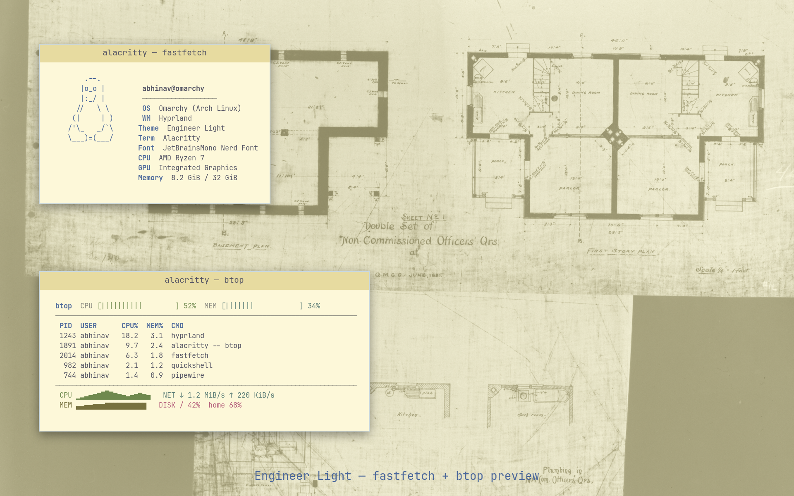

## Install

```bash
omarchy theme install https://github.com/abhinavbxr/omarchy-engineer-light-theme
```

## Try locally

```bash
cp -r /path/to/engineer-light ~/.config/omarchy/themes/
omarchy theme set engineer-light
```

## Palette

Kanagawa **Lotus**-inspired palette defined in `colors.toml` (Omarchy color roles mapped from corresponding Kanagawa Lotus palette colors):

| Role | Color |
| --- | --- |
| Background | `#f2ecbc` |
| Foreground | `#545464` |
| Accent | `#4d699b` |
| Selection | `#b5cbd2` |
| Muted | `#8a8980` |

Omarchy generates application themes from `colors.toml`. All primary/bright color slots in `colors.toml` are mapped from Kanagawa Lotus colors (e.g. `lotusRed`/`lotusRed2`, `lotusBlue4`/`lotusTeal2`, `lotusGreen`/`lotusGreen2`, `lotusAqua`/`lotusAqua2`, `lotusPink`/`lotusViolet4`, etc.).

## Backgrounds

Engineering blueprints/technical drawings and converted real-life engineering/construction imagery (all 2560×1440), sourced from the internet and processed for this theme:

- [`backgrounds/01-fort-myer-blueprint.png`](backgrounds/01-fort-myer-blueprint.png) — converted architectural blueprint (Fort Myer NCO quarters plan)

  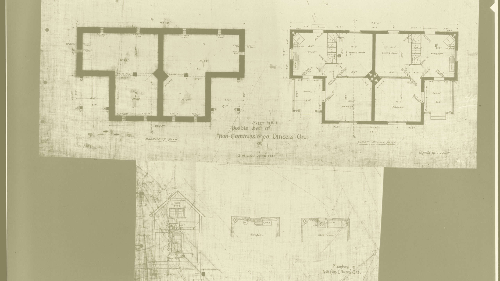

- [`backgrounds/02-glacier-station-blueprint-a.png`](backgrounds/02-glacier-station-blueprint-a.png) — converted engineering blueprint (Glacier Ranger Station plan)

  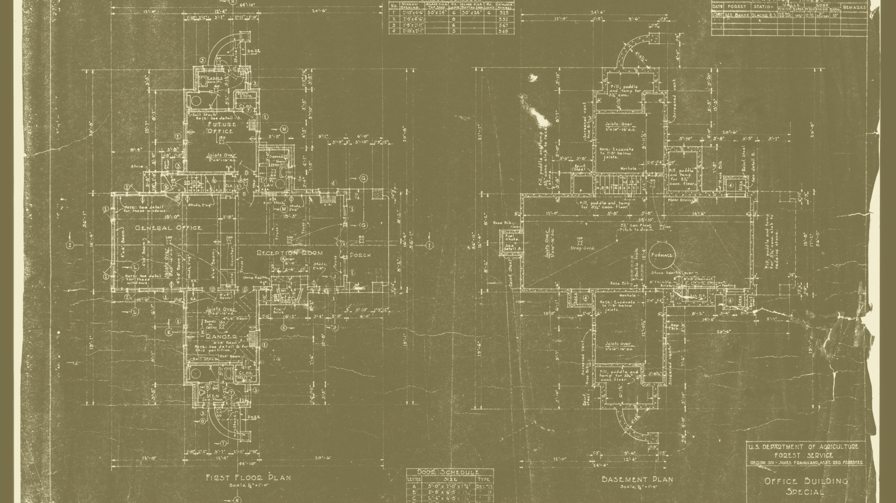

- [`backgrounds/03-glacier-station-blueprint-b.png`](backgrounds/03-glacier-station-blueprint-b.png) — converted engineering blueprint (Glacier Ranger Station elevations)

  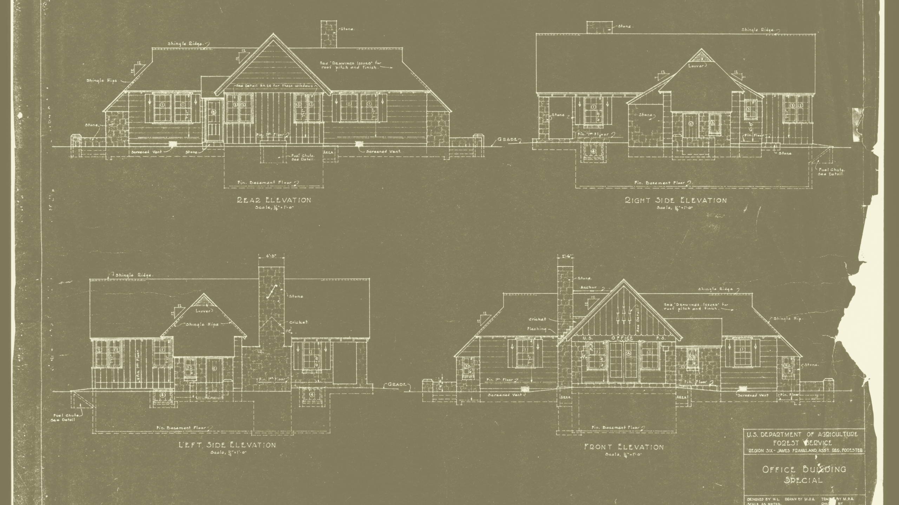

- [`backgrounds/04-pampanga-bridge-construction.png`](backgrounds/04-pampanga-bridge-construction.png) — converted real-life bridge construction photograph

  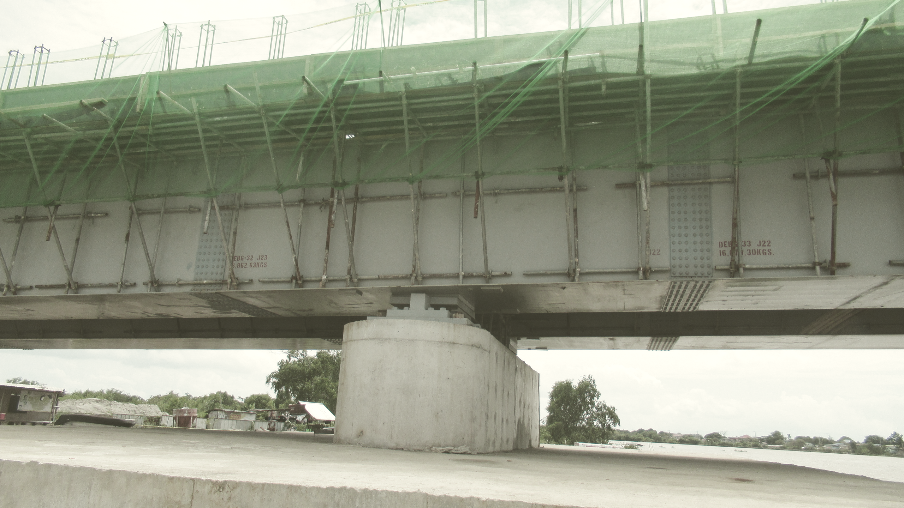

- [`backgrounds/05-pampanga-bridge-construction-ii.png`](backgrounds/05-pampanga-bridge-construction-ii.png) — converted real-life bridge construction photograph

  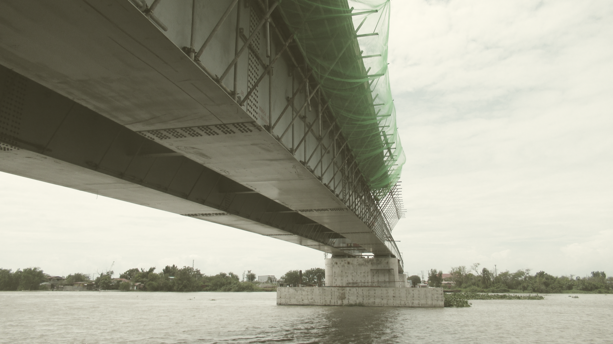

- [`backgrounds/06-fort-macarthur-bldg30-elevations-section-details.png`](backgrounds/06-fort-macarthur-bldg30-elevations-section-details.png) — BLDG. -30; PHOTOCOPY OF BLUEPRINT OF WORKING DRAWING OF ELEVATIONS, CROSS SECTION AND DETAILS — Fort MacArthur engineering blueprint (converted)

  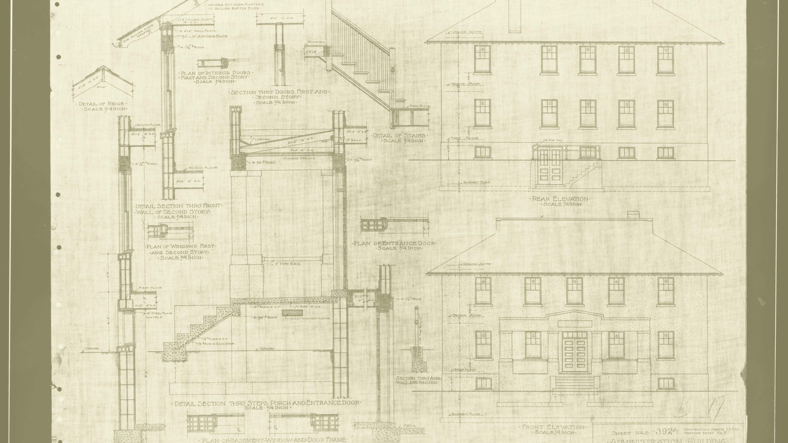

- [`backgrounds/07-fort-macarthur-bldg30-south-elevation-floor-plans.png`](backgrounds/07-fort-macarthur-bldg30-south-elevation-floor-plans.png) — BLDG. -30; PHOTOCOPY OF BLUEPRINT OF WORKING DRAWING OF SOUTH ELEVATION; 3 FLOOR PLANS — Fort MacArthur engineering blueprint (converted)

  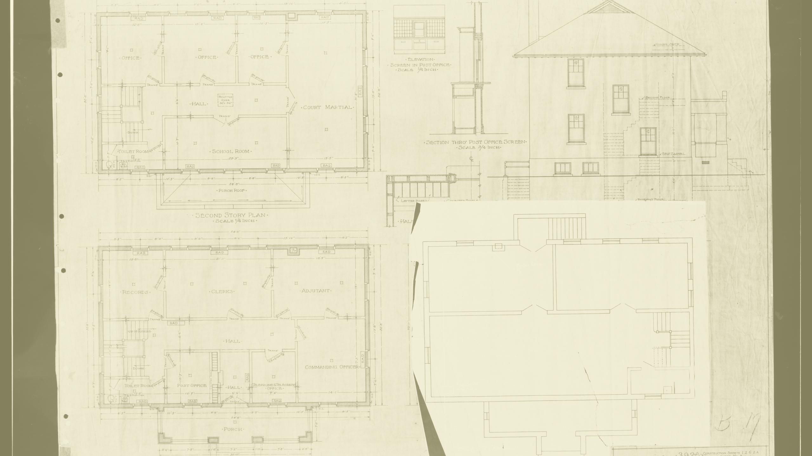

- [`backgrounds/08-fort-macarthur-bldg32-elevations-cross-section.png`](backgrounds/08-fort-macarthur-bldg32-elevations-cross-section.png) — BLDG. -32; PHOTOCOPY OF BLUEPRINT OF WORKING DRAWING OF 2 ELEVATIONS; CROSS SECTION AND DETAILS — Fort MacArthur engineering blueprint (converted)

  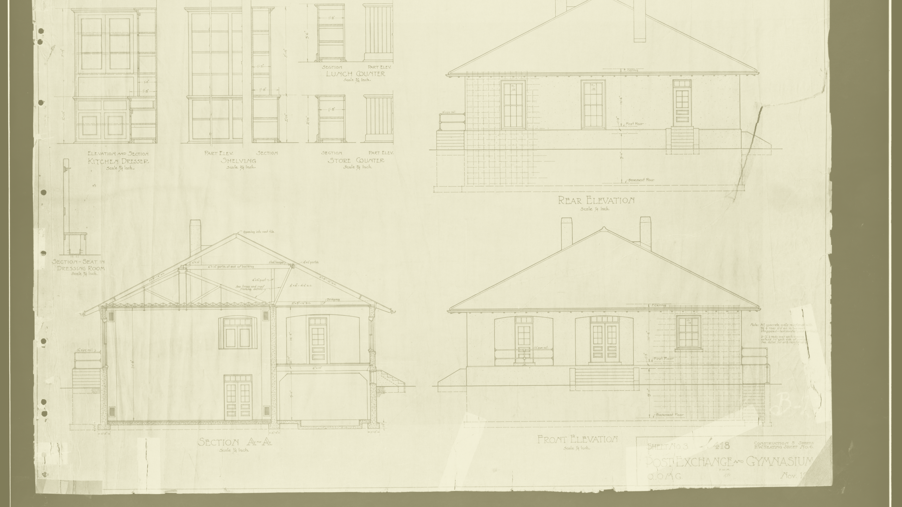

- [`backgrounds/09-fort-macarthur-bldgs-3-7-9-10-three-elevations.png`](backgrounds/09-fort-macarthur-bldgs-3-7-9-10-three-elevations.png) — BLDGS. -3, 7, 9 and 10; PHOTOCOPY OF BLUEPRINT OF WORKING DRAWING OF 3 ELEVATIONS — Fort MacArthur engineering blueprint (converted)

  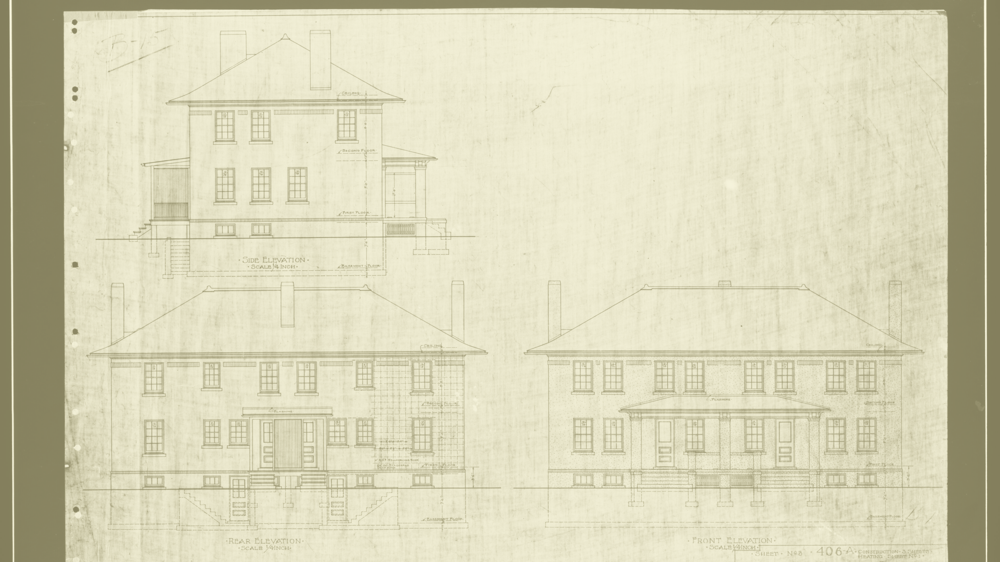

- [`backgrounds/10-fort-macarthur-bldg32-basement-plan.png`](backgrounds/10-fort-macarthur-bldg32-basement-plan.png) — BLDG. -32; PHOTOCOPY OF BLUEPRINT OF WORKING DRAWING OF PLAN OF BASEMENT — Fort MacArthur engineering blueprint (converted)

  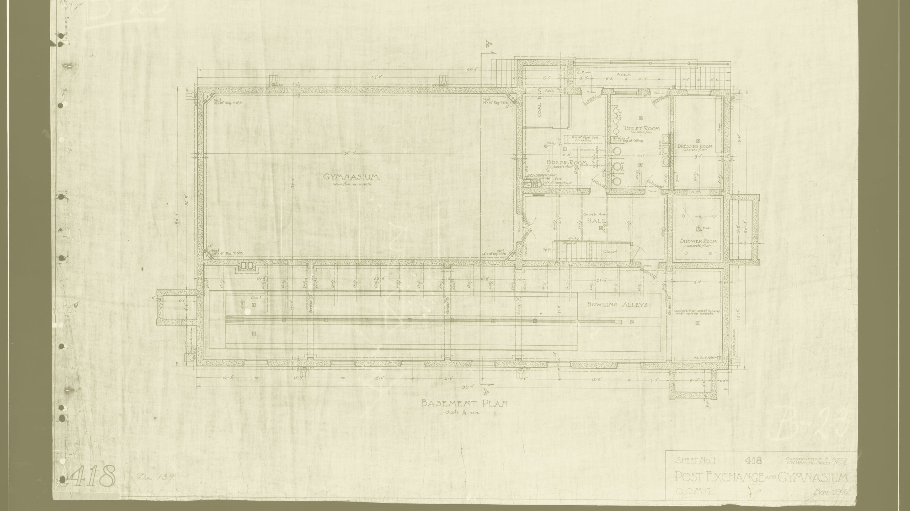

- [`backgrounds/11-fort-macarthur-bldg32-first-floor-plan.png`](backgrounds/11-fort-macarthur-bldg32-first-floor-plan.png) — BLDG. -32; PHOTOCOPY OF BLUEPRINT OF WORKING DRAWING OF PLAN OF FIRST FLOOR — Fort MacArthur engineering blueprint (converted)

  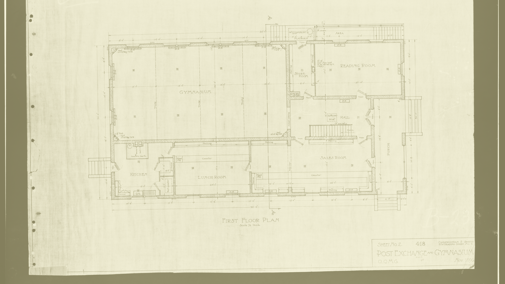

- [`backgrounds/12-fort-macarthur-bldg41-elevations-cross-section.png`](backgrounds/12-fort-macarthur-bldg41-elevations-cross-section.png) — BLDG. -41; PHOTOCOPY OF BLUEPRINT OF WORKING DRAWING OF 2 ELEVATIONS; CROSS SECTION — Fort MacArthur engineering blueprint (converted)

  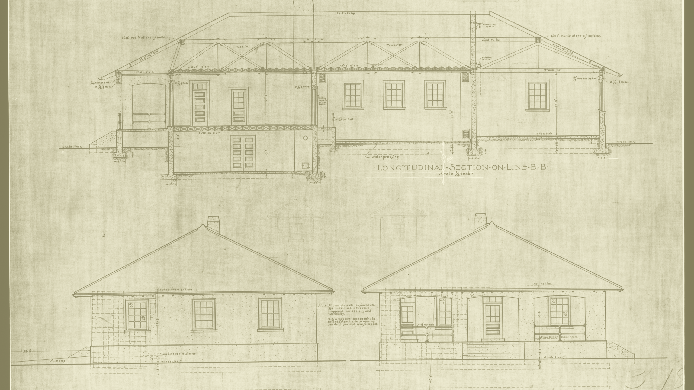

- [`backgrounds/13-fort-macarthur-bldg41-side-elevations.png`](backgrounds/13-fort-macarthur-bldg41-side-elevations.png) — BLDG. -41; PHOTOCOPY OF BLUEPRINT OF WORKING DRAWING OF 2 SIDE ELEVATIONS — Fort MacArthur engineering blueprint (converted)

  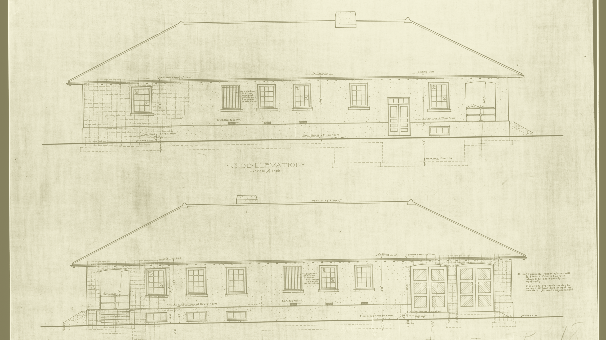

- [`backgrounds/14-fort-macarthur-bldg41-first-floor-plan.png`](backgrounds/14-fort-macarthur-bldg41-first-floor-plan.png) — BLDG. -41; PHOTOCOPY OF BLUEPRINT OF WORKING DRAWING OF FIRST FLOOR PLAN — Fort MacArthur engineering blueprint (converted)

  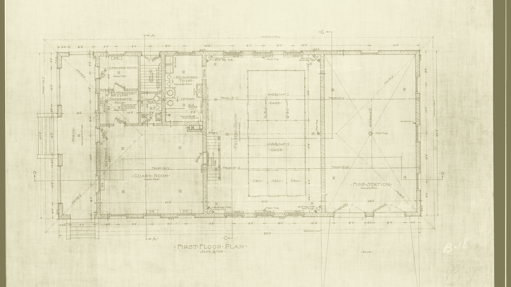

- [`backgrounds/15-fort-macarthur-bldg50-side-elevation-details.png`](backgrounds/15-fort-macarthur-bldg50-side-elevation-details.png) — BLDG. -50; PHOTOCOPY OF BLUEPRINT OF WORKING DRAWING OF SIDE ELEVATION, CROSS SECTION AND DETAILS — Fort MacArthur engineering blueprint (converted)

  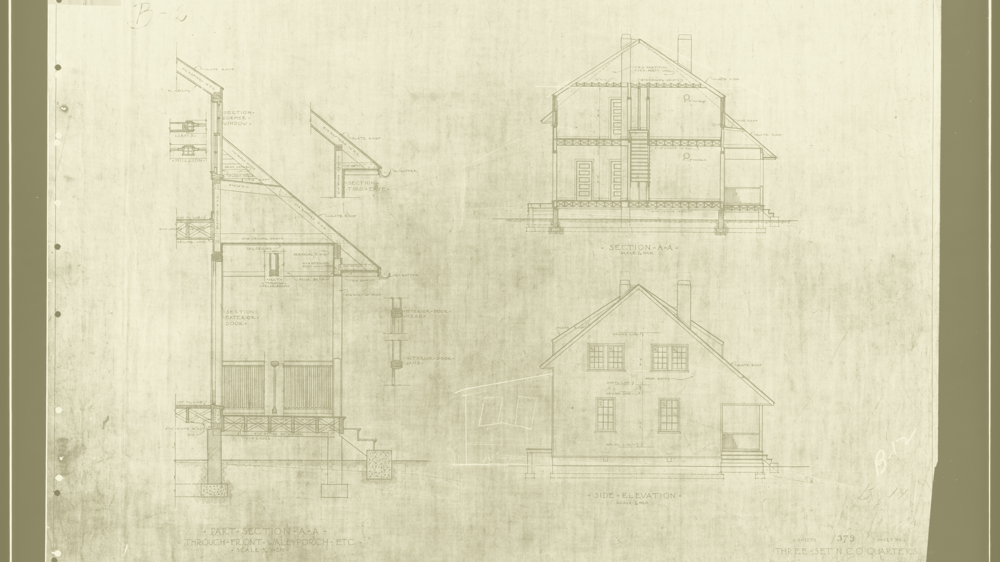

- [`backgrounds/16-canning-dam-construction-1939.png`](backgrounds/16-canning-dam-construction-1939.png) — Canning Dam construction, 1939 — real-life dam construction photograph (converted)

  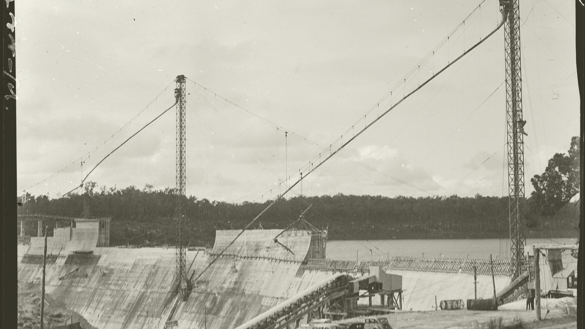

- [`backgrounds/17-wushantou-dam-construction.png`](backgrounds/17-wushantou-dam-construction.png) — Wushantou Dam construction — real-life dam construction photograph (converted)

  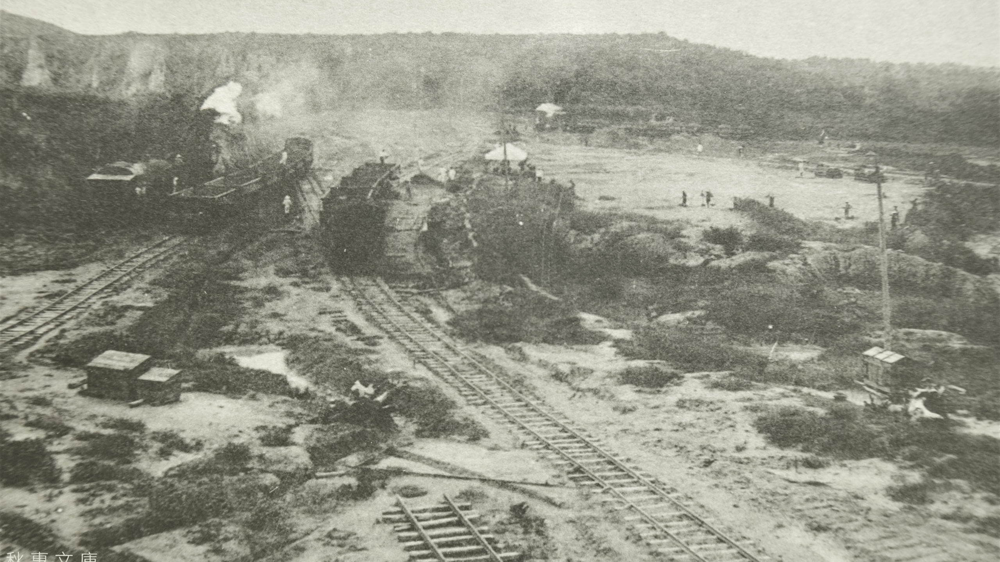

- [`backgrounds/18-melrose-station-dam-construction-1925.png`](backgrounds/18-melrose-station-dam-construction-1925.png) — Melrose Station dam construction, circa 1925 — real-life dam construction photograph (converted)

  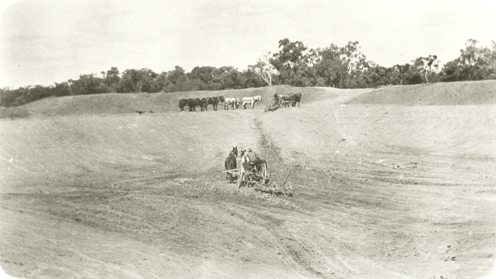

- [`backgrounds/19-iroquois-dam-construction.png`](backgrounds/19-iroquois-dam-construction.png) — Iroquois dam construction — real-life dam construction photograph (converted)

  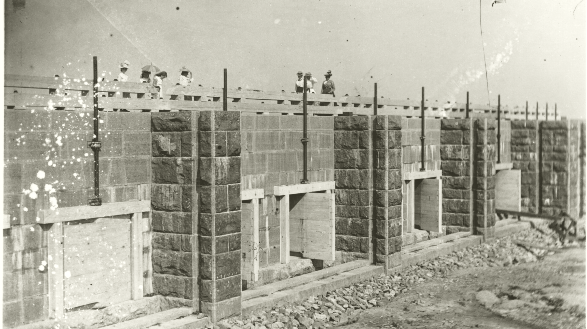

- [`backgrounds/20-francis-e-walter-dam-engineers-office.png`](backgrounds/20-francis-e-walter-dam-engineers-office.png) — Francis E. Walter Dam construction engineer's office — real-life construction photograph (converted)

  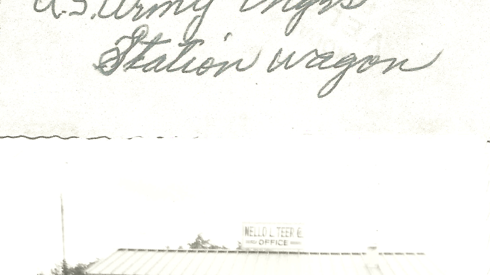

- [`backgrounds/21-francis-e-walter-dam-water-truck.png`](backgrounds/21-francis-e-walter-dam-water-truck.png) — Francis E. Walter Dam construction water truck — real-life construction photograph (converted)

  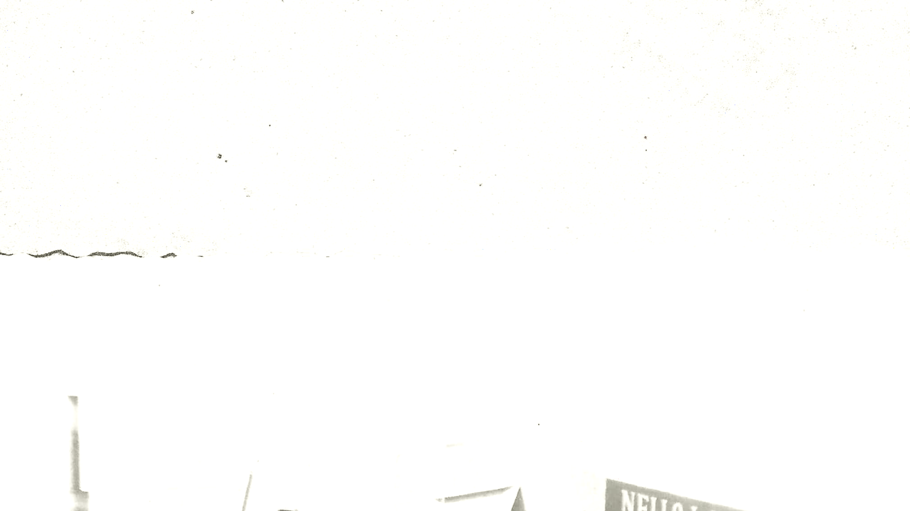

- [`backgrounds/22-hardy-dam-construction-1929.png`](backgrounds/22-hardy-dam-construction-1929.png) — Hardy Dam construction, 1929 — real-life dam construction photograph (converted)

  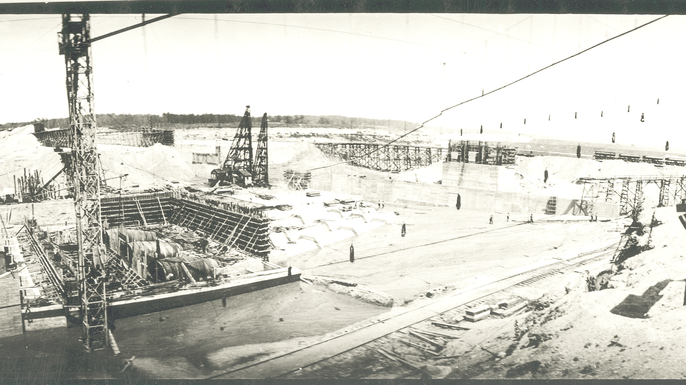

- [`backgrounds/23-santa-rosa-dam-construction.png`](backgrounds/23-santa-rosa-dam-construction.png) — Santa Rosa dam construction — real-life construction photograph (converted)

  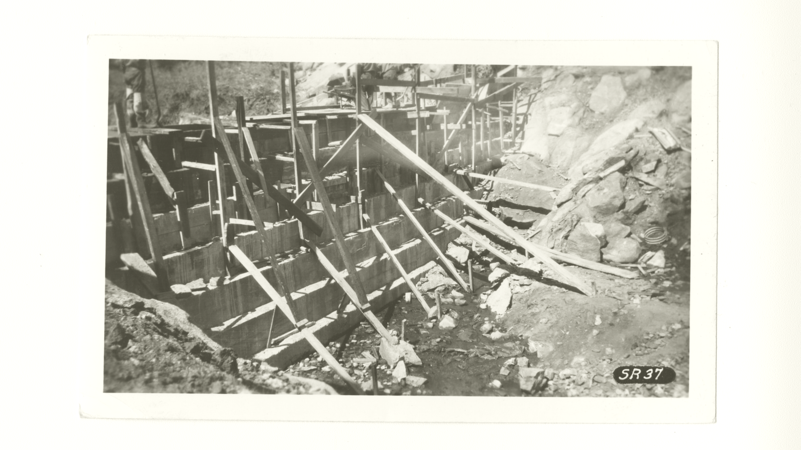

- [`backgrounds/24-samal-bridge-construction-008.png`](backgrounds/24-samal-bridge-construction-008.png) — Samal Bridge construction 008 — real-life bridge construction photograph (converted)

  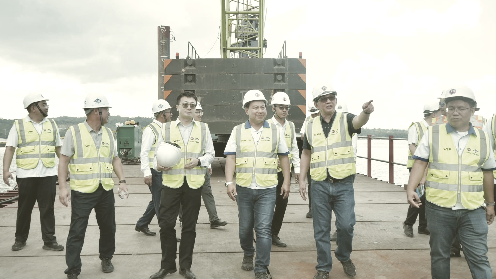

- [`backgrounds/25-samal-bridge-construction-009.png`](backgrounds/25-samal-bridge-construction-009.png) — Samal Bridge construction 009 — real-life bridge construction photograph (converted)

  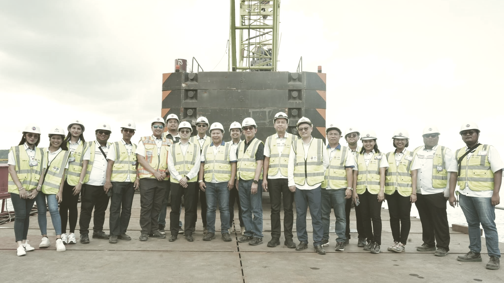


Cycle backgrounds with `omarchy theme bg next`.

## Previews

- `preview-fastfetch-btop.png` — 1920×1200 preview composition showing fastfetch and btop
- `preview.png` — 1600×1000 base preview image
- `preview.webp` — 1200×675 web preview asset

## Files

- `colors.toml` — core theme palette
- `icons.theme` — icon theme name (`Yaru-blue`)
- `backgrounds/` — theme wallpapers (25 images)
- `ATTRIBUTION.md` — source image credits and licenses
- `preview-fastfetch-btop.png`, `preview.png`, `preview.webp` — preview assets
- `README.md`, `LICENSE`

## Image sources & attribution

Backgrounds are converted/processed from Wikimedia Commons sources (including public domain HABS/HAER/NARA/government engineering drawings and photographs, plus other permissively licensed images as noted). See [`ATTRIBUTION.md`](ATTRIBUTION.md) for full source links, authors, and license details.

## Community theme compatibility

Prepared for [omarchy-site community theme submission guidelines](https://github.com/omacom/omarchy-site#adding-your-theme) (not submitted). Before submitting, replace the preview with a real 16:9 desktop screenshot of the theme in use (terminal + editor visible, using this theme’s wallpaper).

## License

MIT (theme files). See `ATTRIBUTION.md` for third-party image source licenses/credits.
